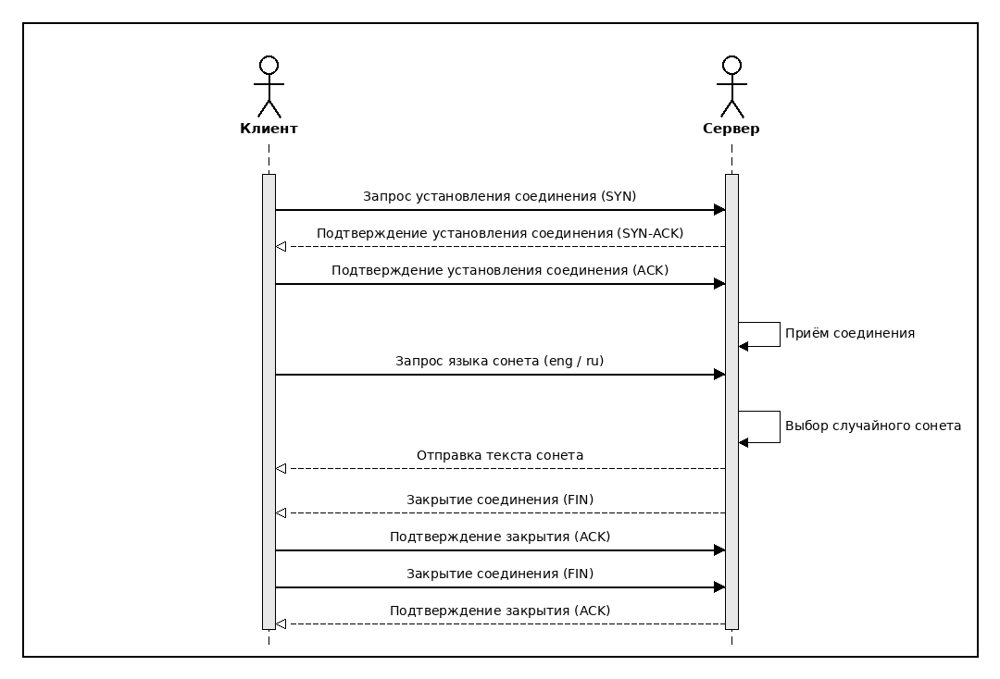
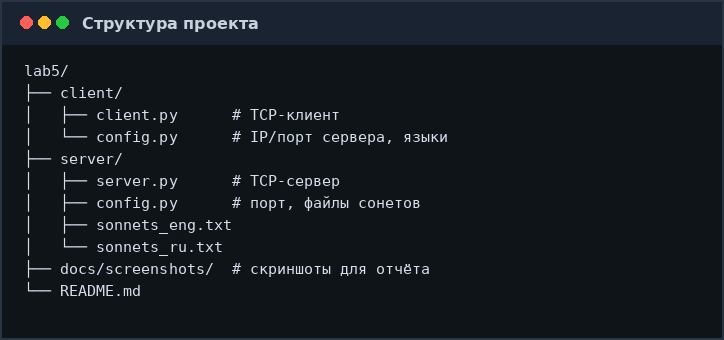
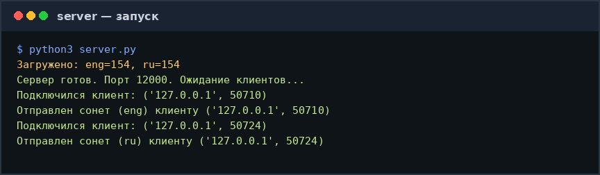
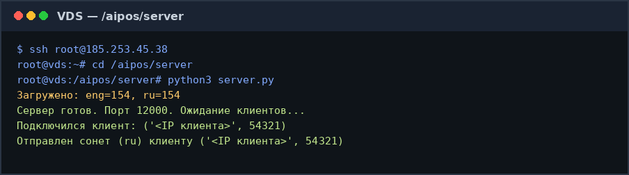
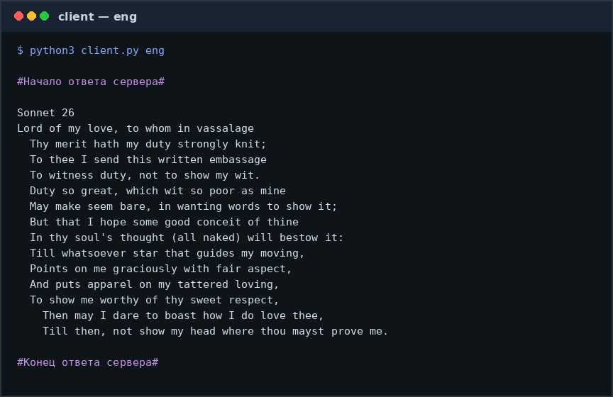
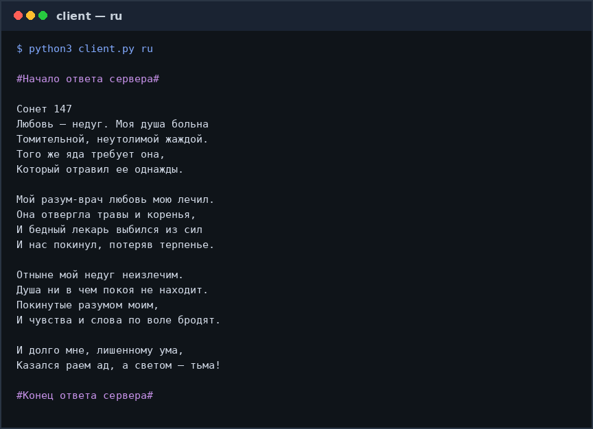

# Лабораторная работа №5  
## Программирование сокетов: клиент-серверное приложение

**Дисциплина:** Аппаратное и программное обеспечение сетей (АИПОС)  
**Вариант:** 8  
**Тема:** клиент при обращении к серверу получает случайно выбранный сонет Шекспира из файла  

---

## 1. Цель работы

Познакомиться с основами программирования сокетов на языке Python и реализовать сетевое приложение «клиент — сервер» с использованием протокола **TCP**.

---

## 2. Постановка задачи

Согласно варианту 8 необходимо:

1. Реализовать **серверную** часть приложения.
2. Реализовать **клиентскую** часть приложения.
3. На сервере хранить сонеты Шекспира в файле.
4. При обращении клиента сервер должен **случайно** выбрать сонет и отправить его клиенту.

### Доработка

- Поддержка двух языков: **английский** (`eng`) и **русский** (`ru`, перевод С. Маршака).
- Разделение сонетов в файле символом `#`.
- Вынесение настроек в отдельные `config.py` для клиента и сервера.
- Возможность запуска сервера на удалённом VDS, а клиента — на локальном ПК.

---

## 3. Архитектура решения

Используется транспортный протокол **TCP** (`SOCK_STREAM`):

- клиент устанавливает соединение через `connect()`;
- сервер принимает соединение через `listen()` / `accept()`;
- тройное рукопожатие выполняется операционной системой на транспортном уровне.

### Диаграмма последовательности обмена



---

## 4. Структура проекта



| Путь | Назначение |
|------|------------|
| `server/server.py` | TCP-сервер: слушание порта, выбор и отправка сонета |
| `server/config.py` | Порт, пути к файлам, кодировка, разделитель |
| `server/sonnets_eng.txt` | 154 сонета на английском |
| `server/sonnets_ru.txt` | 154 сонета на русском |
| `client/client.py` | TCP-клиент: запрос языка и вывод ответа |
| `client/config.py` | IP и порт сервера, буфер приёма, языки |
| `docs/screenshots/` | Скриншоты работы для отчёта |

---

## 5. Протокол прикладного уровня

Простой текстовый протокол поверх TCP:

1. Клиент отправляет одну строку: `eng` или `ru` и символ перевода строки.
2. Сервер читает язык, выбирает случайный сонет из соответствующего файла.
3. Сервер отправляет текст сонета в выбранной кодировке (настраивается в `config`: `ENCODING`, по умолчанию UTF-8) и закрывает соединение.
4. Клиент читает данные до закрытия соединения и печатает результат.

Разделитель сонетов в файлах — символ `#` (каждый следующий сонет начинается с `#` и перевода строки).

---

## 6. Запуск

### 6.1. Сервер (локально или на VDS)

```bash
cd server
python3 server.py
```



### 6.2. Клиент

В `client/config.py` укажите адрес сервера:

```python
SERVER_NAME = "127.0.0.1"      # локально
# SERVER_NAME = "185.253.45.38"  # пример: VDS
SERVER_PORT = 12000
```

Запуск:

```bash
cd client
python3 client.py eng
python3 client.py ru
# или без аргумента — клиент спросит язык интерактивно
```

### 6.3. Развёртывание сервера на VDS

```bash
# с локального ПК
ssh USER@HOST "mkdir -p /aipos"
scp -r server USER@HOST:/aipos/

# на VDS
ssh USER@HOST
cd /aipos/server
python3 server.py
```



> На VDS должен быть открыт порт!

---

## 7. Результаты работы

### Английский сонет (`eng`)



### Русский сонет (`ru`)



При каждом новом запуске клиента сервер возвращает **случайный** сонет из выбранного языкового набора.

---

## 8. Ключевые моменты реализации

### Сервер

- `socket(AF_INET, SOCK_STREAM)` — IPv4 + TCP;
- `bind` / `listen` — входной (listening) сокет;
- `accept` — создание сокета соединения для конкретного клиента;
- загрузка сонетов один раз при старте;
- `random.choice` — случайный выбор;
- `sendall` + `close` сокета соединения.

### Клиент

- `connect((SERVER_NAME, SERVER_PORT))` — установка TCP-соединения;
- отправка языка одной строкой;
- чтение ответа циклом `recv` до закрытия соединения сервером;
- вывод сонета в терминал.

---

## 9. Выводы

1. Реализовано клиент-серверное приложение на сокетах Python с использованием **TCP**.
2. Выполнен вариант 8: сервер отдаёт случайный сонет Шекспира из файла.
3. Добавлена поддержка двух языков и вынос настроек в конфигурационные файлы.
4. Проверена работа локально и при размещении сервера на удалённом хосте.

---

## 10. Контрольные вопросы

| Вопрос | Ответ |
|--------|--------|
| Что такое сокет? | Интерфейс между приложением и транспортным уровнем |
| Почему TCP? | Нужна надёжная доставка целого текста сонета |
| Где handshake? | На транспортном уровне ОС при `connect`/`accept` |
| Зачем файл на сервере? | Данные и логика выбора централизованы на сервере |
| Чем UDP отличается? | Без соединения, без гарантии доставки |
